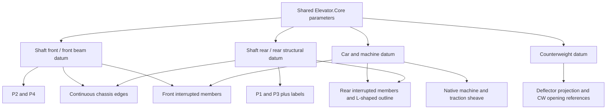

# Chassis dependency correction — 14 September 2026

The old `machine` role rigidly translated 912 entities, including 617 P1–P4 details and chassis edges whose endpoints belong to different datums. This allowed valid dimensions and semantic IDs while the frame lost its structural support alignment. The correction changes the reviewed geometry dependencies, not PlanUpdater or the 250/400 mm sheave rules.

## Reviewed dependencies

Review used native reference vertices, straight-edge topology, common endpoint rows, the original drawing's visible P1–P4 callouts, and final native geometry plots. It identified three continuous longitudinal edges, six front-to-machine edges, five straight machine-to-rear edges and one L-shaped rear outline. That last outline includes both a rear crosspiece and a leg ending at the machine crosspiece. Sixteen imported vector contours spelling P1/P3 also require the rear-support relationship.

The source values in `config/chassis-topology.json` are measured shaft-local topology identifiers. They are not fixed world positions, standard hardware sizes or structural design rules. The reviewed edge counts and label-contour counts must match; a different topology is rejected rather than guessed. The label windows identify visually reviewed lettering; they are not used to infer chassis-member purpose.

The rear structural strip is the one drawn behind the shaft rear face. Geometric bearing in that strip is verified; the DWG does not establish its material, reinforcement or capacity. A direct mechanical mounting between the deflector and chassis cannot be confidently inferred from the plan alone.

## Exact role changes

Existing semantic IDs and all 1,354 native entities are retained. The additive dependency object in each binding stores the transformation behavior, semantic endpoint references and native offsets. Older `Role=machine` remains as migration provenance; when `Dependency` exists the updater dispatches through it instead of the old rigid mapper.

| Existing semantic group | Count | Old movement | New behavior | References |
|---|---:|---|---|---|
| Chassis.ReferenceDetail: continuous edges | 3 | Rigid `machine` | SpanBetweenReferences | FrontBeam and RearBeam endpoints |
| Chassis.ReferenceDetail: front interrupted edges | 6 | Rigid `machine` | StretchFromCarSide | Machine end and FrontBeam end |
| Chassis.ReferenceDetail: rear edges and L-shaped outline | 6 | Rigid `machine` | StretchFromCWRearSide | Machine end and RearBeam end/crosspiece |
| Support.P1 | 150 | Rigid `machine` | FixedToBeam | RearBeam, shaft center in X |
| Support.P3 | 149 | Rigid `machine` | FixedToBeam | RearBeam, shaft center in X |
| Support.P2 | 159 | Rigid `machine` | FixedToBeam | FrontBeam, shaft center in X |
| Support.P4 | 159 | Rigid `machine` | FixedToBeam | FrontBeam, shaft center in X |
| Chassis.ReferenceDetail: 16 P1/P3 label contours and one end detail | 17 | Rigid `machine` | FixedToBeam | Corresponding rear/front datum |
| MachineChassis.ReferenceDetail: one end detail | 1 | Rigid `machine` | FixedToBeam | Corresponding support datum |
| Remaining machine/chassis/traction and car-label details | 262 | Rigid `machine` | FixedToMachine | Shared car/machine datum, shaft center |
| CW opening contours and note | 18 | Rigid `cw` | RigidTranslate, with explicit audit references | Shared CW datum, shaft center |

The implementation does not force use of every possible behavior category: no arbitrary DerivedFromMultipleReferences or uniform scale is assigned. Straight members are reconstructed endpoint-by-endpoint; the L outline's crosspiece moves with the rear support while its machine endpoint follows the machine. Native X offsets, duplicate vertices and end details remain. Hardware and plates use rigid displacement; circle radii, profile vertices and retained details are checked.

## Persistence and existing drawings

`MachineRoomBindings` now contains `DependencyVersion=1`, per-entity dependency records and structural datum offsets. The prepared master includes them. Existing version-zero projects can migrate during UPDATEALL: their old rigid movement is inverted relative to the shared local frame to recover the reviewed source, then the topology must match before dependencies are installed. Migration is inside the update transaction and preserves XData IDs. No entity handles or enumeration order are used.

These bindings preserve the reviewed dependency graph. Changes to connection topology, profile shape or equipment configuration require a reviewed binding update. Replacing a native object while retaining its identifier and expected geometry is supported. An unknown semantic ID outside the manifest is rejected as an orphan.

## Final geometry audit

`MachineRoomGeometryAudit` checks 930 dependency-bound entities, 2,850 native reference points and 20 span-to-actual-support connections in the tested reference. Checks run during UPDATEALL, again after regeneration, and in tests after reopening saved DWGs. The result is embedded as `MachineRoomGeometryAudit`. `ELEVATORMRAUDIT` runs a read-only audit on the current drawing against its stored project data.

Checks include:

- Native chassis endpoints/vertices against their individual machine/front/rear references; noncollapsed spans.
- Span ends against actual P1–P4 support-plate rows, retaining native offsets rather than inventing coincident endpoints where the source has offsets.
- P1–P4 footprint coverage within the actual front beam/rear structural strip, retaining the measured reference overlap. No structural minimum bearing is selected.
- Actual structural boundary vertices against the front/rear datums, including a displaced-beam fault.
- Machine/traction profiles and bound car-related details against shared car and shaft-center references; CW opening contours and their note against the shared CW reference.
- Deflector CW endpoint, center-mark alignment, existing pitch/visibility checks and unchanged seven-entity suppression behavior.
- The existing shared axes and 14 dimension checks, plus rejection of an inconsistent purely numeric dimension-text override.
- Detached bound annotation contours, missing/duplicate/orphan semantic IDs, unexpectedly hidden chassis/support details, and retained native circle radii.

This is a scoped geometric audit, not a general collision engine. Detailed rope swept envelopes, unspecified machine/deflector mounting, working clearances, arbitrary new equipment, arbitrary formatted dimension overrides and text collisions are not fully validated. Structural adequacy, material, loads, reinforcement and allowable bearing remain **NOT EVALUATED**. Preserving top-view projection overlap does not establish a physical collision or clearance without vertical geometry. These limits remain explicit in the audit result and engineering report; a PASS applies to the listed geometric relationships.

## Verification

The complete native suite passes:

- 32 machine-room records: prepared master/import; 19 updates with saved-DWG reopen; missing ID, duplicate ID and replacement-object tests; nine intentional geometry faults rejected.
- Required SD 1400, 1600, 1800 and 2000 at SW 1450 all pass. TZ values are 650, 750, 850 and 950 respectively.
- Same-drawing 1400 → 2000 → 1600 passes without cumulative point/shape drift. Existing smaller/larger widths, threshold transitions, rotation, translation and absent/250/400 switching also pass.
- Faults: displaced span, support, machine, CW opening, deflector center mark, car annotation, numeric dimension override, hidden support and displaced beam. Each fault is rolled back after proving that the audit rejects it.
- Original Plan tests: 17 CAD records, 14 architecture records (including seven unchanged golden comparisons), one command workflow and seven plan-completeness records all pass. PlanUpdater was not changed.
- Pure tests: 43 original sizing assertions, six annotation checks and 39 machine-room Core checks pass.

Evidence: `tests/machine-room-results.json`, `tests/generated/machine-room.log`, `tests/machine-room/chassis-evidence-*.json` and `tests/machine-room/chassis-depth-comparison.png`. The image is a diagnostic plot of final native vertices in local frames, not a fully rendered AutoCAD sheet. Review of that plot caught and corrected the rear L outline and P1/P3 lettering before the final test run.

## Load and use this build

The previous `bin` DLL was locked by a running process. The tested build is therefore in **`bin-chassis`**; the running session and original binaries were left intact.

1. Restart AutoCAD to unload the previous assembly.
2. NETLOAD `ElevatorAutomation/bin-chassis/Elevator.AutoCAD.dll`; retain the adjacent Core DLL and project config folder.
3. Open the existing project, edit SW/SD with ELEVATORPROJECT, then run UPDATEALL. Existing legacy bindings migrate when their reviewed topology matches. A separate output DWG is saved.
4. Open that saved output and run ELEVATORMRAUDIT for an independent read-only check.

Reproduce the build and tests with `tests/run-tests.ps1 -BinDirectory bin-chassis`. Do not reload the old `bin` plug-in for this correction. The machine-room master is prepared with the new dependency manifest; no original user DWG is overwritten. Code diameter-ratio warnings, wrap status separation and market sizes 250/400 remain unchanged.
