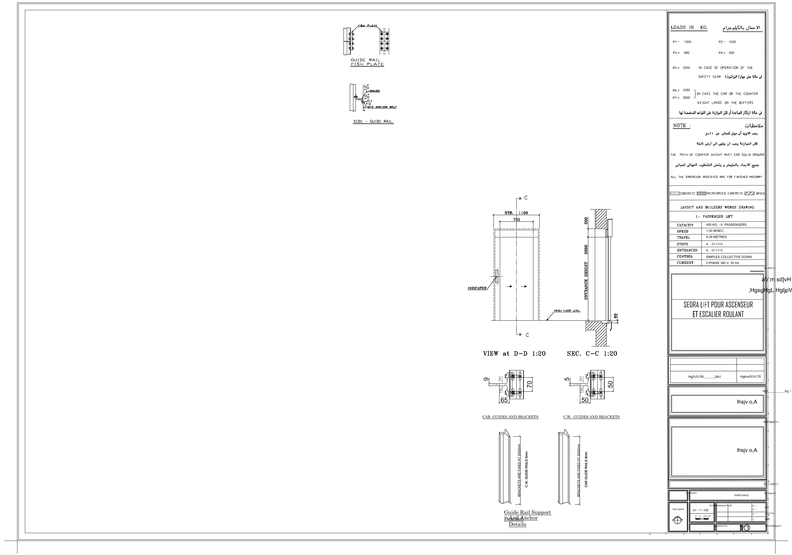
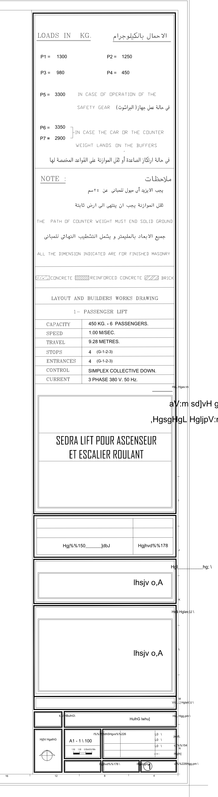

# Layout templates: analysis of `01_Geared_MR_1-1_LAYOUT.dxf` (L1)

Status: analysis only (2026-10-12, branch `feature/layouts-l1`). No application code changed. The source DXFs in `Layouts_Sec/` were opened read-only.
Binding context: [`DESIGN-FLOW.md`](../../../../DESIGN-FLOW.md), section "Layouts and PDF", including the decisions of 2026-10-12.
Tool: [`tools/inspect_layout_dxf.py`](tools/inspect_layout_dxf.py) (Python + ezdxf 1.4.4) reproduces every number below. No Core Console plot was run (see 6.4).

Conventions: coordinates are **paper-space units**; one unit is 9.969 mm (see 1), so about 1 cm. Model-space units are millimetres.

## Summary of what matters

1. **The sheet is A0 landscape (1189 x 841 mm), not A1.** The title block's scale cell reads "A1 - 1 \ 100", but the frame, the layout and the plot setup are all A0. DESIGN-FLOW says A1. Open question 1.
2. **Paper space is drawn in centimetres** and plotted with "1 inch = 2.5479 units" (the file's plot setup). The viewports "11 x 17" style sizes you saw are therefore centimetres, not inches.
3. **The three big viewports (plan, section, overview) are empty in this file.** Their view definitions are kept, the sample project geometry is not in the model. Only four small detail viewports show anything.
4. **93,012 model-space entities, of which 3,065 are used by this layout.** The rest is a library of other sheets (swing doors, automatic doors, rail-combination details, hydraulic jack-rail loads, roping symbols). That is why the file is 44 MB.
5. **The title block is mostly geometry, not text.** 1,976 polylines and 1,492 splines on paper space are the flattened labels (English and Arabic). Only 36 TEXT and 29 MTEXT entities exist: the values and the Arabic field labels. The label text is not editable as text.
6. **The Arabic texts need `xarab.shx` and `cadnw-1` / `cent.shx`**, which are not AutoCAD standard fonts. Without them the PDF shows Latin gibberish. Decoded in 2.3.
7. **The plot settings use `PDFCreator.pc3` (a third-party printer) and a stale plot window** that does not cover the sheet. Both must be replaced.
8. **The L2a `TitleBlockData` covers the value block (speed, load, travel, stops, floors, control, supply, P1-P7) and company, project, client, prepared / checked / approved, date, revision.** It does not cover: the logo, the Arabic company line, the drawing number (sheet number), phase, project number, type of work, the Arabic drawing title, the revision table rows, the entrances count, the north arrow and the bar scale. P1-P7 are "N kN (kg)" on the L2a branch, but the 2026-10-12 decision is kg only.

## 1. Paper, units, scale, plot settings

| Item | Value in the template |
|---|---|
| Format | DXF AC1032 (AutoCAD 2018). One paper-space layout, named `Geared Rear CW`, plus `Model`. |
| Paper | 841.0 x 1188.8 mm (A0), stored portrait, `plot_rotation = 1` (90 degrees), so it plots **landscape 1189 x 841 mm**. `paper_size` field `120 842 1190`. |
| Margins | all 0. |
| Plot device | `PDFCreator.pc3` (third-party PDFCreator printer). Not available on a clean machine and not in Core Console. |
| Plot style | `monochrome.ctb` (named plot styles off: `$PSTYLEMODE = 1`). Paper-space label polylines are colour 7 with lineweight 0.20 mm. |
| Plot type | 4 = window. **Window (-170.9, -136.7) to (-52.2, -52.3) does not match the sheet** (the sheet is at x -44.3 to 74.4). Layout limits are stale in the same way. Plotting "as stored" would print the wrong area. |
| Plot scale | 1 : 2.5479 with `plot_paper_units = 0` (inches): 1 inch of paper = 2.5479 units, so **1 paper unit = 9.969 mm**. The designer drew in cm and the 0.3 % error comes from using 2.5479 instead of 2.54. |
| Units | `$INSUNITS = 1` (inches), `$MEASUREMENT = 0` (imperial) in the header, while model geometry is in mm and paper space in cm. The header is not meaningful; do not rely on it. |
| Layer for viewport borders | `view port` (colour 4, **no-plot**), so viewport frames do not plot. `Defpoints` is no-plot too. |

### Sheet geometry (paper units)

| Element | Rectangle |
|---|---|
| Outer sheet border | (-44.32, -136.74) to (74.39, -52.38): 118.7 x 84.4 units = 1183 x 841 mm |
| Inner frame | (-44.12, -136.54) to (74.19, -52.58) |
| Drawing area | (-43.1, -135.5) to (57.4, -53.6): 100.5 x 81.9 units = 1002 x 816 mm |
| Title-block band | x 57.5 to 73.2 (15.7 units = 157 mm wide), y -135.5 to -53.6 (816 mm high) |
| Zone marks | `16 12 8 4` along the bottom edge, `I J K L M N` along the right edge (static, layer `ACDC BANDA`) |
| Stray items | two plot-marker polylines on layer `Text` at (-46.3, -138.8) and (74.4, -138.8), outside the sheet; 24 border lines on layer `0` |

*Render made with ezdxf + matplotlib: paper space plus each viewport's model window. Fonts are substituted, so Arabic and SHX text looks different from AutoCAD. The three large empty areas are the empty viewports of 3.*

## 2. The title block

Zoomed halves: [top](geared-title-block-top.png), [bottom](geared-title-block-bottom.png).

The block is a column 157 mm wide at the right of the sheet. From top to bottom:

1. **Loads** (`LOADS IN KG.` / Arabic): P1-P7 and two static explanations.
2. **Notes** (static English and Arabic).
3. **Legend** (concrete, reinforced concrete, brick hatches; static).
4. **Drawing title** (`LAYOUT AND BUILDERS WORKS DRAWING`, `1- PASSENGER LIFT`; static geometry).
5. **Data table** (capacity, speed, travel, stops, entrances, control, current).
6. **Company box** (Arabic and French company name, logo).
7. **Revision table** (3 rows).
8. **Owner**, **Project name**, **Project number** boxes.
9. **Type of work** and **Drawing name** row.
10. **Bottom rows**: north arrow, scale cell, prepared / checked / approved table, then date, phase and drawing number cells.

### 2.1 Fields that carry a value (text entities)

Positions are the text insertion points (paper units). "Template value" is what the file shows; values are all from an earlier sample project.

| Field | Position | Template value | Source in ShaftMaster | L2a `TitleBlockData` | Covered |
|---|---|---|---|---|---|
| P1 label / value | (58.4, -58.4) / (60.0, -58.4) | `P1 =` / `1300` | chassis bearing reaction P1 (live calculation) | `P1` | yes, but format differs (below) |
| P2 | (65.5, -58.4) / (67.1, -58.4) | `1250` | P2 | `P2` | same |
| P3 | (58.4, -60.1) / (60.0, -60.1) | `980` | P3 | `P3` | same |
| P4 | (65.5, -60.1) / (67.1, -60.1) | `450` | P4 | `P4` | same |
| P5 | (58.3, -62.5) / (59.9, -62.4) | `3300` | safety-gear load per car guide rail | `P5` | same |
| P6 | (58.3, -66.0) / (59.9, -65.9) | `3350` | load of one car buffer | `P6` | same |
| P7 | (58.3, -67.2) / (59.9, -67.1) | `2900` | load of one counterweight buffer | `P7` | same |
| Rated load and persons | (63.6, -87.0) | `450 KG. - 6  PASSENGERS.` | `Elevator.CapacityKg`, `PresetLibrary.PersonsFor` | `RatedLoad` | yes (template has two spaces before PASSENGERS, L2a one) |
| Rated speed | (63.6, -88.0) | `1.00 M/SEC.` | `Elevator.SpeedMetresPerSecond` | `RatedSpeed` | yes |
| Travel | (63.6, -89.0) | `9.28 METRES.` | lowest to highest served floor | `Travel` | yes |
| Stops (count) | (63.6, -90.1) | `4` | served floors | `Stops` | yes |
| Stops (names) | (64.4, -90.1) | `(G-1-2-3)` | served floor names | `Floors` | yes |
| **Entrances (count)** | (63.6, -91.1) | `4` | entrances = openings served (front and rear count separately) | none | **no** |
| **Entrances (names)** | (64.4, -91.1) | `(G-1-2-3)` | as above | none | **no** |
| Control | (63.5, -92.1) | `SIMPLEX COLLECTIVE DOWN.` | title-block preset `Control`, lockable | `Control` | yes |
| Current (supply) | (63.5, -93.0) | `3 PHASE 380 V. 50 Hz.` | title-block preset `Supply`, lockable | `Supply` | yes |
| Company name, French line | (59.9, -99.3), 2 lines, Agency FB 0.9 | `SEDRA LIFT POUR ASCENSEUR ET ESCALIER ROULANT` | company settings | `CompanyName` | yes, one line only |
| **Company name, Arabic lines** | (72.2, -95.5) and (70.2, -97.1), xarab 0.64 | شركة سيدرا ليفت للمصاعد / والسلالم المتحركة | none (only one company name exists) | none | **no** |
| **Company logo** | OLE frame (62.31, -102.17) to (68.33, -106.68): 6.0 x 4.5 units = 60 x 45 mm | "Picture (Device Independent Bitmap)" | `CompanyReportSettings.LogoFile` (PNG / JPEG) | none (not in `TitleBlockData`) | **no** |
| Owner / client | box (57.7..72.8, -110..-117), placeholder MTEXT at (68.4, -114.7) | Arabic placeholder "ماستر ..." | `Report.ClientName` | `Client` | yes |
| Project name | big box, placeholder MTEXT at (68.4, -122.2) | same Arabic placeholder | `Info.Name` | `ProjectName` | yes |
| **Project number / code** | label (72.5, -128.0), thin box, no value in the template | empty | `Report.DocumentNumber` (exists in the model, not in `TitleBlockData`) | none | **no** |
| **Type of work** | label (60.4, -129.4), small box, no value | empty | none | none | **no** |
| **Drawing name (Arabic)** | label (72.6, -129.4), value (68.0, -129.8) | أعمال مصاعد ("elevator works") | none | `DrawingTitle` is "" and has no source | **no** |
| Scale | (61.5, -132.2) ACDC 0.34 | `A1 - 1 \ 100` | none | `Scale` is "" and has no source | **no** |
| Prepared by | table row 1, name cell right of the `م.` prefix at (70.7, -131.4) | empty | `Report.PreparedBy` | `PreparedBy` | yes |
| Checked by | row 2, (70.7, -132.6) | empty | `Report.CheckedBy` | `CheckedBy` | yes |
| Approved by | row 3 (70.6, -133.4) | empty | `Report.ApprovedBy` | `ApprovedBy` | yes |
| Date | bottom-left cell, box x 57.7 to 64 at y about -134.6 | empty | issue date | `Date` | yes |
| **Phase** | bottom-middle cell, box x 64 to 69 | empty | none | none | **no** |
| **Drawing number** | bottom-right cell, circle with `1` at (69.9, -135.0), height 0.62 | `1` | sheet number (1 of 1) | none | **no** |
| Revision | the 3-row revision table above the owner box | empty | `Report.Revision` (number only, 2026-10-12 decision) | `Revision` | partly: the table has description and date columns, L2a has one number |

Notes on the P values. The P1-P4 cells are a 2 x 2 grid and P5-P7 a stack; the template prints the number only, under the header "LOADS IN KG." The 2026-10-12 decision is `P1 = 545 KG.` (value text including the unit). **L2a on the branch produces "12.35 kN (1260 kg)"**, which does not fit the 5.1-unit-wide value cell and contradicts the decision. `TitleBlockData.P1..P7` must change to the kg-only form before L2b.

### 2.2 Static content (no value comes from the project)

All of this is plain geometry (polylines / splines), so it is part of the template as it is:

- Headers and labels: `LOADS IN KG.` / الاحمال بالكيلوجرام, `NOTE :` / ملاحظات, the row labels `CAPACITY SPEED TRAVEL STOPS ENTRANCES CONTROL CURRENT`.
- The two load explanations: `IN CASE OF OPERATION OF THE SAFETY GEAR` (+ Arabic), `IN CASE THE CAR OR THE COUNTERWEIGHT LANDS ON THE BUFFERS` (+ Arabic) with the bracket joining P6 and P7.
- The notes: "any tilt of the buildings more than +-2 cm must be reported", "the counterweight path must end on solid ground", "all dimensions are for finished masonry" (each in Arabic and English).
- The hatch legend: concrete, reinforced concrete, brick.
- `LAYOUT AND BUILDERS WORKS DRAWING` and `1- PASSENGER LIFT`. The second line is system-specific: the hydraulic template has `HYDRAULIC ELEVATOR` as MTEXT, the gearless ones have `GEARLESS 2:1 ELEVATOR`.
- The north arrow symbol (layer `ProfileEdges`: 2 circles, 7 lines) at about (58.3 to 59.9, -134.1 to -133.0).
- The bar scale (`0`, `0.50`, `1.00`, `1.50`, in metres) in the scale cell. It is only valid for one scale.
- Zone marks.

### 2.3 Arabic and SHX texts decoded

The Arabic labels are TEXT / MTEXT in SHX fonts `xarab` (style `ACDC_Xarab`) that store the Arabic letters as Latin key codes of the Arabic keyboard layout, in reading order; `%%nnn` are the font's own extended codes. Decoded by that layout and checked against the context (the French company line has the same words):

| Template string | Reading | Meaning |
|---|---|---|
| `Hgl___________hg; \` | المالك | OWNER (client) |
| `Hs? Hglav,U \` | اسم المشروع | PROJECT NAME |
| `VrL ,:,] HglaV,U \` | رقم كود المشروع | PROJECT NUMBER / CODE |
| `HsL Hgg,pm \` | اسم اللوحة | DRAWING NAME |
| `vr%%226Hgg,pm \` | رقم اللوحة | DRAWING NUMBER |
| `k,U HBulhG\` | نوع الأعمال | TYPE OF WORK |
| `HulhG lwhu]` | أعمال مصاعد | "ELEVATOR WORKS" (the value of the drawing name) |
| `l%%158dhSHgvs%%226` | مقياس الرسم | SCALE |
| `Hj{hI HgalhG` | اتجاه الشمال | NORTH DIRECTION |
| `Hgjhvd%%178` | التاريخ | DATE |
| `Hglvpgm \` | المرحلة | PHASE |
| `jwldL` | تصميم | DESIGN (prepared by) |
| `v,{%%154` | روجع | CHECKED (reviewed) |
| `Hujlh]` | اعتماد | APPROVED |
| `Hgj%%150_______]dbJ` | التعديل | REVISION |
| `w%%156v` | صفر | ZERO (bar scale) |
| `HsL Hgav:m` | اسم الشركة | COMPANY NAME (label) |
| `aV:m sd]vH gdtJ gglwhu]` / `,HgsgHgL HgljpV:m` | شركة سيدرا ليفت للمصاعد / والسلالم المتحركة | the company name in Arabic |
| `L0 \` (x3), `L0 H0 \` | `م.` | "Eng." prefix before the person's name |
| `lhsjv o,A` (x2, large) | not decoded | placeholder text inside the owner and project boxes |

Two codes are not certain: `%%154` was read as ع from the word روجع, and `lhsjv o,A` was not resolved (it is a placeholder that the original author overwrote per project).

## 3. Viewports

Seven model viewports plus the paper-space viewport (id 1, layer `0`). Scale is the real plotted scale: `1 / (viewport height / view height x 9.969 mm)`. The model window is `view target + view centre` (the stored centre is relative to the target).

| VP | Paper centre | Size (units / mm) | Scale | Model window (mm) | Entities | What it shows | ShaftMaster view |
|---|---|---|---|---|---|---|---|
| 2 | (10.8, -63.9) | 10.7 x 16.6 / 106 x 166 | 1:10.03 | x -12586..-11519, y 32686..34348 | 978 | guide-rail fish plate and side-of-rail fixing (`GUIDE RAIL FISH PLATE`, `SIDE - GUIDE RAIL`, L 50x50, M12 anchor bolt) | template detail (static) |
| 3 | (11.3, -104.8) | 23.4 x 61.5 / 233 x 613 | 1:35.11 | x 131881..140055, y -79965..-58448 (8.2 x 21.5 m) | **0** | empty: full-height overview | **section A-A or B-B overview (dynamic)**, see below |
| 4 | (-21.3, -94.4) | 41.9 x 81.7 / 418 x 814 | 1:9.03 | x 124767..128538, y -75788..-68438 (3.8 x 7.3 m) | **0** | empty: the largest viewport | **section A-A (dynamic)** |
| 5 | (40.1, -113.6) | 25.1 x 9.7 / 250 x 96 | 1:8.38 | x 15667..17761, y 28334..29142 | 298 | `CAR GUIDES AND BRACKETS` and `C.W. GUIDES AND BRACKETS` in plan (rail 9 / 5 mm, 65 / 50 mm brackets) | template detail (static) |
| 6 | (37.9, -127.0) | 17.2 x 16.2 / 172 x 162 | 1:5.64 | x 15567..16535, y 31970..32882 | 68 | `Guide Rail Support Bracket And Anchor Details`: rails with brackets fixed at 2000 mm, 9 mm car, 5 mm C.W. | template detail (static) |
| 7 | (40.0, -67.3) | 30.5 x 26.7 / 305 x 266 | 1:10.03 | x 125486..128541, y -68564..-65893 (3.1 x 2.7 m) | **0** | empty: the shaft plan | **plan (dynamic)** |
| 8 | (38.2, -94.5) | 25.0 x 26.9 / 249 x 268 | 1:15.34 | x -29676..-25854, y 32352..36460 | 1723 | door elevation `VIEW at D-D` and `SEC. C-C` (700 mm door, STR. 1100) | template detail (static) |

Observations:

- The numbering in the file is not the order on the sheet. Positions on the sheet (see the render): plan VP7 top-middle, door detail VP8 under it, then VP5 and VP6 (bracket details) at the bottom of the middle column; VP3 (tall, narrow) left of the middle column, VP4 (largest) at the far left, VP2 (fish plate) top-left of the middle column.
- **Assignment of the three empty viewports is inferred.** VP7 and VP4 have almost the same model X range (125486..128541 and 124767..128538) and VP4 starts right under VP7 (y -68438 against -68564): a plan with the section drawn straight below it, the classic orthographic arrangement. VP3 sits to the right of them in model space at 1:35 and shows 21.5 m of height. So: VP7 = plan, VP4 = section, VP3 = the full-height overview. Whether VP4 is A-A and VP3 B-B (machine room section) or the reverse is not decidable from the file. Open question 2.
- **Scales are not standard** (1:9, 1:8.4, 1:5.6, 1:15.3, 1:35): the viewports were fitted by zooming, not set to a scale. The text under VP8 says "1:20" while the viewport is 1:15.3, so the printed scale and the real scale disagree.
- No viewport has frozen layers (the file stores none) and none is clipped to a non-rectangular boundary.
- The three empty viewports' model windows lie around (126000, -70000) and (135000, -69000) mm: a region of model space that contains nothing in this file (the sample project was removed).

## 4. Model-space content

93,012 entities (Gearless 2:1 and Hydraulic: the same 93,012; Forklift: 95,388). The model is a **library**: details of many earlier sheets, laid out side by side across 150 m x 37 m. Nothing in it is a complete sample project.

| Content | Where (mm) | Entities | Belongs to |
|---|---|---|---|
| Fish plate, side-of-rail fixing | x -12.5k..-11.6k, y 32.7k..34.3k | 978 | **template detail**, used by VP2 |
| Car / C.W. guide and bracket plans | x 15.7k..17.8k, y 28.3k..29.1k | 298 | **template detail**, used by VP5 |
| Guide-rail support bracket and anchors | x 15.6k..16.5k, y 32.0k..32.9k | 68 | **template detail**, used by VP6 |
| Door elevation + section C-C, 700 mm | x -29.7k..-25.9k, y 32.4k..36.5k | 1,723 | **template detail**, used by VP8 |
| Rail-combination detail sets (5-9-3, 5-9, 5-16, 9-16, 9-16-2.0, 16-16-2.0), anchor-bolt sheets | x 5k..36k, y 25k..38.6k | 19,015 (incl. the 366 of VP5 / VP6) | **library, unused here.** Relevant to the rail-profile library (rail sizes 5 / 9 / 16 mm). [Render](model-space-bracket-details.png) |
| Swing doors, about 25 variants with `VIEW at D-D` / `SEC. C-C` | x -88k..-47k, y 23k..42k | 29,624 | **library, unused here.** [Render](model-space-swing-doors.png) |
| Automatic doors, about 35 variants + door-head details | x -47k..-21k, y 4k..41k | 37,844 (incl. the 1,723 of VP8) | **library, unused here.** [Render](model-space-automatic-doors.png) |
| Roping symbols (indirect / direct 1:1 and 2:1) and rail-fixing 3D view | x 36k..44.6k, y 30.7k..37k | 1,536 | library (small icons for other systems). [Render](model-space-roping-symbols.png) |
| Jack-rail load diagrams (hydraulic, 150..650 KG), hydraulic cylinder symbols | x -21k..5.1k | 4,993 (incl. the 978 of VP2) | library (hydraulic). [Render](model-space-jack-rail-loads.png) |
| Plan / section / overview of a sample project | would be at x 125k..141k, y -80k..-58k | **0** | **absent**: this is where VP3 / VP4 / VP7 point |

So 3,065 entities (3.3 %) carry the four static detail viewports and everything else is unused by this layout. A reduced copy of the DXF with only those entities (model space cut down, paper space kept), saved by ezdxf, is **9.8 MB**, of which 7.5 MB is entity data: the flattened label splines and polylines dominate. Further reduction is possible by converting the flattened labels to text (about 40 strings) and exploding nothing else.

## 5. Fonts, text styles, layers, blocks, dimension styles

### Text styles

| Style | Font | Used for | Needs |
|---|---|---|---|
| `Standard` | arial.ttf | MTEXT value cells (with inline `\Fcadnw-1`) | clash: the generated drawings also have a `Standard`; the inline font override makes the clash harmless, but the font behind it must exist |
| `ACDC` | arial.ttf | scale text `A1 - 1 \ 100` | ok |
| `ACDC_Xarab` | **xarab.shx** | all Arabic field labels | **not an AutoCAD font** |
| `nassar2` | cent.shx, height 60 | detail annotations in model space | **cent.shx** not standard |
| `top` | cent.shx, height 40 | | same |
| `Century Gothic$001H0` | cent.shx | | same |
| `ELEV_STYLE` | txt.shx, height 2.5 | | standard |
| `PDF Arial`, `PDF Arial Bold` | arial.ttf, arialbd.ttf | detail text from PDF import | ok |
| inline fonts in MTEXT | `cadnw-1` (value cells), `xarab`, `cent`, `Agency FB` (company name) | | `cadnw-1` and `xarab` and `cent` are user fonts; `Agency FB` is an Office TrueType font |

### Layers (23)

`0`, `ACDC BANDA` (title block), `ProfileEdges`, `Text`, `view port` (no-plot), `Defpoints` (no-plot), `1-5`, `3`, `6`, `8`, `AM_HID`, `Car`, `CL`, `DL`, `Layer1`, `PDF_0`, `PDF_001`, `PDF_gide rail`, `PDF_SAS_STB_Side`, `PDF_Text`, `step&guides`, `Wall`, `WIN`.

**Names that clash with what ShaftMaster generates** (from `Elevator.AutoCAD`): `0`, `Car`, `CL`, `DL`, `step&guides`, `Defpoints`, `Text`. They come from the same legacy source, so the meaning is probably the same, but colour and linetype must be compared before inserting (template: `CL` colour 2 `CENTER`, `DL` colour 8 `ACAD_ISO02W100`, `Car` colour 3, `step&guides` colour 3). Not yet compared (needs the generated DWG's layer table; local). ShaftMaster-only layers not in the template: `AA_Datum`, `EVX_`.

### Linetypes, blocks, dimension styles

- Linetypes: `ACAD_ISO02W100`, `AM_ISO02W050`, `CENTER`, `CENTER2` (plus Continuous). The ISO ones ship with AutoCAD.
- Blocks: `A$C18F36B25` (552 entities), `LD_20211208183909_00000021`, `LD_20220801141428_00000002`, `LD_20220801141428_0000000A`, `_ArchTick`, `_Oblique`. Names are unlikely to clash.
- Dimension styles: `Copy of ISO-25` (current, `DIMSCALE` 0.5), `ISO-25`, `Standard`, `Nassar2`, `top`. The model-space detail dimensions (354 dimensions) use them. **`ISO-25` and `Standard` clash with AutoCAD built-ins**: an inserted detail would take the target drawing's definition of those names (different text height or arrows). Rename on import (see 6.2).
- Not present: no `IMAGE` in the geared file (the Forklift template has one `IMAGE` reference), one OLE frame (the logo).

## 6. Proposed implementation for L2b / L3 (not implemented)

### 6.1 A smaller template under `ElevatorAutomation/Templates`

1. Build `Templates/Layout_GearedRCW_A0.dxf` (DXF, not DWG, so it is diffable, produced by a Python script that is cloud-runnable, and AutoCAD / Core Console read it with `Database.DxfIn`).
2. Keep: the paper-space layout, frame and title block (3,647 entities), the four static detail viewports with their 3,065 model entities (placed in model space at a reserved offset), the layer, style and linetype definitions.
3. Drop: the 89,947 library entities, unused blocks, all stale plot settings.
4. Convert the flattened labels to text (about 40 strings: English labels with `romans` or Arial, Arabic with a TrueType font such as Arial / Tahoma / Segoe UI as Unicode). That removes the font dependency of 2.3 and most of the 7.5 MB.
5. Rename on import to an own prefix: layers keep their names only where ShaftMaster already uses them; dimension styles and text styles become `SMT_ISO25`, `SMT_Arabic`, and so on.
6. Target size: **below 2 MB** after step 4. Measured today with only the entity cut: 9.8 MB.
7. Replace the title-block value texts by **attribute definitions** in one block `SM_TITLEBLOCK` (tags below). Filling attributes is robust and testable; matching MTEXT by position is not.

### 6.2 Placement and scaling of the generated views

- The generated views stay in model space (as now). The layout gets **one viewport per generated view**, with the template's rectangles from the table in 3: plan -> VP7, section -> VP4, overview -> VP3.
- For each viewport: take the view's drawing extents (the existing per-view frame or manifest) plus a dimension margin, choose the **largest standard scale** (1:5, 1:10, 1:20, 1:25, 1:50, 1:75, 1:100, 1:150, 1:200) whose window fits the viewport rectangle, centre it, then set `ViewCenter`, `ViewHeight = viewport height / scale factor` and lock the viewport scale. The template's non-standard scales (1:9, 1:35) are not kept.
- The window and viewport are derived from the shaft size and stop count: plan from `SW x SD`, section from overall height (pit + travel + overrun + machine-room height). For tall sections the scale falls back (1:35 now fits 21.5 m; more stops choose 1:50 or 1:75).
- The four static detail viewports keep their windows. Their model entities are copied at a reserved offset to the right of the generated views.
- The paper unit stays centimetres (so the detail windows are unchanged) or is converted to millimetres at import; choose one and write it into the template. Recommended: **keep mm paper units** in the new template (`1 unit = 1 mm`, plot scale 1:1 on "ISO A0") so the viewport maths has no 9.969 factor.

### 6.3 Title-block filling

| Attribute tag | `TitleBlockData` member | Change needed |
|---|---|---|
| `COMPANY` (French / English line) | `CompanyName` | none |
| `COMPANY_AR` | none | new optional setting in the shared company settings, or omit the Arabic line |
| `LOGO` | none | the logo file path from `CompanyReportSettings.LogoFile`; replace the OLE frame with an `IMAGE` reference (or an embedded raster) in the 60 x 45 mm area. Avoid OLE (not portable, not plottable on a clean machine) |
| `PROJECT`, `CLIENT` | `ProjectName`, `Client` | none |
| `DOC_NO` (project number) | none | add `DocumentNumber` from `Report` |
| `DRAWING_NAME` | `DrawingTitle` | give it a source (the template value "elevator works") or fix it static |
| `SCALE` | `Scale` | fill from the chosen viewport scales (see Q5) |
| `PREPARED`, `CHECKED`, `APPROVED`, `DATE`, `REVISION` | same names | revision table rows beyond the current number need a model (Q6) |
| `SPEED`, `LOAD`, `TRAVEL`, `STOPS`, `FLOORS`, `CONTROL`, `SUPPLY` | `RatedSpeed`, `RatedLoad`, `Travel`, `Stops`, `Floors`, `Control`, `Supply` | none |
| `ENTRANCES`, `ENTRANCE_NAMES` | none | add; for one-sided geared lifts this equals Stops |
| `P1`..`P7` | `P1`..`P7` | **change to kg only: "P1 = 545 KG." value cell text `545 KG.`** |
| `PHASE`, `TYPE_OF_WORK`, `SHEET_NO` | none | add or leave empty (Q7) |

A missing value is written as empty, never a placeholder (DESIGN-FLOW principle). The north arrow, bar scale and notes stay static; the bar scale should be removed or generated from the scale.

### 6.4 PDF through AutoCAD Core Console

- Replace `PDFCreator.pc3` with **`DWG To PDF.pc3`** (ships with AutoCAD) and the paper `ISO full bleed A0 (1189.00 x 841.00 MM)` or `ISO A0 (841.00 x 1189.00 MM)` with rotation 90; keep `monochrome.ctb` (ships in AutoCAD's Plot Styles; verify it is present where Core Console runs). Set the plot area to **Layout** (or to the frame rectangle), scale 1:1.
- Do it in the plug-in, not in a `-PLOT` script: a command `ELEVATORPLOTPDF` using `PlotSettingsValidator` + `PlotEngine` (`PlotFactory.CreatePublishEngine`), run by `accoreconsole.exe /i <dwg> /s <script>` with `BACKGROUNDPLOT = 0`. Rationale: explicit control of device, media, style sheet and area, and a readable error when one is missing.
- Not tested in this task. It needs a local spike: does `DWG To PDF.pc3` with `monochrome.ctb` and TrueType Arabic reproduce the sheet in Core Console, and how long does it take for a full project?

### 6.5 Where the file-name builder is called

At the three outputs of one run, so one base name is computed once:
`BaseName(project, library, counterweight)` -> `Files(baseName)` gives `.dwg`, `.pdf`, `.elevator.json`. Call it in the project save path (project file), the drawing generation path (DWG output path, never overwriting the source) and the PDF export (same folder, `.pdf`). The counterweight code is `RCW` for every geared project now (2026-10-12 decision). Call sites belong to L3; L2b only needs the name for the sheet's own file stamp if that is wanted.

### 6.6 Tests

- Tier 1 (cloud, net8.0): `TitleBlockData` kg-only strings; the attribute-tag map is complete (every tag has a source or is declared empty); the viewport-scale chooser (property tests: window always inside the viewport, scale in the series, stable for stop counts 2..40 and shaft sizes in the library); file-name builder (already in L2a).
- Python / ezdxf test on the template DXF (cloud-runnable): paper A0, no `PDFCreator.pc3`, plot window equals the frame, all viewport rectangles inside the frame, no entity outside the frame, layer and style names are the agreed set, no font file that is not in the allowed list, file below 2 MB.
- Tier 3 (local, Windows): generate the layout into a test DWG, reopen it, compare every attribute value to `TitleBlockData`; plot to PDF through Core Console and check page count, page size (1189 x 841 mm) and that the PDF text contains the project name and `P1 =`; golden: rendered PNG of the sheet compared to an approved picture.

## 7. Open questions for the user

1. **A0 or A1?** The sheet, frame and plot setup are A0 (1189 x 841 mm); the scale cell says "A1 - 1 \ 100" and DESIGN-FLOW says A1. Which paper size is the product? (If A1, the template must be scaled by 0.707 and the details re-checked at the viewport scales.)
2. Which view goes where? Inferred: VP7 plan (1:10), VP4 section (largest, 1:9), VP3 full-height overview (1:35). Is the overview the machine-room section B-B, or a second view of A-A, or the whole building?
3. The sample project was removed from the template. Should the machine-room plan and any other view be added to the sheet, or are plan + sections + the four details the complete geared sheet?
4. The door elevation (VP8) and bracket details (VP5, VP6) show one fixed sample (700 mm door, 9 / 5 mm rails, brackets at 2000 mm). On a project with a different door or rail they would be wrong. Until the detailing stage, is the fixed sample acceptable, or should the rail details switch to the template's variants by rail size (5-9, 5-16, 9-16 exist in the library) and the door elevation come from the D1-D4 door layout now?
5. **Scale field:** the template has one scale ("1/100", with a bar scale). With viewports at 1:10 and 1:35 what should it show: "AS SHOWN", the plan scale, or a list?
6. **Revision table:** keep the table (3 rows, description + date) or only the revision number? A table needs a revision history in the project.
7. Fields the template has and the model does not: logo (use the company logo; OK to drop OLE for an image), Arabic company line, project number (use `Report.DocumentNumber`), phase, type of work, drawing number, drawing name, entrances. Which are wanted, and with which value?
8. **Language:** the notes and labels are English + Arabic. Keep both on every sheet? The Arabic needs a TrueType Arabic font and shaping; that is a rewrite of about 40 strings.
9. **Fonts:** `xarab.shx`, `cadnw-1`, `cent.shx` are not standard. May the layout use only TrueType (Arial / Tahoma) instead, so a PDF made on any machine looks the same?
10. The L2a branch writes "N kN (kg)" for P1-P7 and one company line. Confirm both change to kg-only and to the shared company settings as the 2026-10-12 decision says (this needs a small L2a follow-up before L2b).
11. The four DXFs are already tracked in git since commit `23b12df` and are on `origin/main` (about 17 MB packed). `.gitignore` now blocks further copies but does not untrack them. Untrack them (`git rm --cached`, files stay on disk; a cloud session would then not have the templates) or leave them tracked?

## 8. The other three templates, briefly

All three have the same A0 paper, `PDFCreator.pc3`, `monochrome.ctb`, 1 unit = 9.969 mm, the same title-block frame and Arabic labels, and the same 23 layers and 5 dimension styles. The model library is shared (93,012 entities; Forklift 95,388).

| File | Layout | Viewports | Differences from geared |
|---|---|---|---|
| `Gearless_2-1_LAYOUT.dxf` | `Gearless Adjacent` | 7 (VP2..VP8) | Sample values 480 KG, 6 passengers, 15.00 m, 5 stops. Title `GEARLESS 2:1 ELEVATOR`. No `P1 =` text entities were found (the loads may be drawn as geometry; not checked). Extra field `ENTRANCES` as MTEXT; notes in Arabic. Viewport scales 1:8 to 1:30, one of them 42 x 81 units like the geared VP4. Style `ARA` (xarab) added; `Standard` uses `txt`. |
| `Gearless_2-1_Forklift_LAYOUT.dxf` | `Gearless Forklift` | 8 (VP2..VP9) | `GEARLESS 2:1 FORKLIFT ELEVATOR`, 450 KG, 6.00 m, 2 stops. P1-P5 present as MTEXT (2275, 3120, 3400, 3695, 2500), project label `SHRIMPO RESTAURANT ...`. One `IMAGE` entity (external reference) and 2 extra blocks. Style `A4` = arabtype.ttf. |
| `07_Hydraulic_2-1_Single-Cylinder.dxf` | `Hydraulic 2-1` | 9 (VP2..VP10) | `2:1 SINGLE CYLINDER HYDRAULIC ELEVATOR`, 0.52 m/s, 320 KG, 9.00 m, floors `4 (BM-G-1-R)`. Adds a hydraulic block: suspension, oil volume (60 L), min / max pressure (18.70 / 33.99 BAR). Project label `VILLA M139`, other company line `EGYPT ENGINEERS FOR ELEVATOR`. One OLE frame. |

Each has sample-project text from a past job in it (restaurant, villa, a second company name). For those systems the same cleanup as 6.1 applies: remove the previous job's text, then map the fields as in 6.3. The geared template is the only one analysed in detail.
