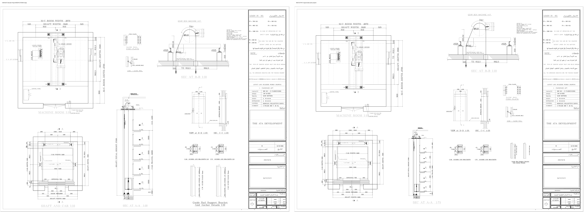

# L2c: the user's own edit of the A0 sheet, as rules (2026-10-12)

Files (copies in this folder; the originals in `output/solution-v01/` were not touched):

| Copy | Original | Saved | What it is |
|---|---|---|---|
| `program-output.dwg` | `Elevator Project.dwg` | 22:22 | the program's output (L2b fix round code) |
| `user-edit.dwg` | `Elevator Project-MODIFICATIONS1.dwg` | 22:52 | the user's edit of it (a subset of it with the changes below; handles of the untouched entities are the same) |
| `user-project.elevator.json` | job `7de19d05…` | 22:22 | the project both were made from (shaft 1620 x 1800, 5 stops, 630 kg, manual door) |
| `user-title-block.json` | the program output's attributes | | the title-block values used to regenerate |

The content confirms the order: the program output has the 8 viewports and titles the L2b code writes, the edit changes them (and nothing the
program writes was added by the program afterwards). Method: both DWGs through the Core Console to DXF (with a timeout), then a diff by handle
with ezdxf (`tests/integration/dwg_to_dxf.py`); sheets plotted with `tests/integration/plot_layouts.py`.

*Left: the user's edit. Right: the project regenerated by the new code.*

## What changed, as rules

"matches" = the L2b code already did this; "new" = implemented in this round.

### The sheet

| # | Rule | Status |
|---|---|---|
| 1 | **A viewport shows everything its view draws, including the view's own title, with a small margin.** The program's viewports were computed from AutoCAD's extents of the view, and the title texts are MTEXT with a reference box wider than the text (the A-A title's box is 15.4 m for a 1.5 m text): A-A got a 310 mm viewport, the user cut it to 195 mm. Now the extents use each text's drawn size. Margin 100 mm model (was 40). | **new** |
| 2 | **The shaft plan has a visible title "SHAFT AND CAR 1:N" under it.** The plan's own title entity is hidden (invisible, Z -137) in the generated drawing, so the sheet had no plan title at all: the user copied the machine-room title, edited it and put it under the plan, centred. The sheet now adds an untagged title there (his copy carries the machine-room semantic key, a duplicate that the host's duplicate-key audit would reject). | **new** |
| 3 | **The titles print at 8 mm.** B-B 100 mm at 1:20 (5 mm) became 80 mm at 1:10 (8 mm), the same as the plan and the machine room (80 mm at 1:10). A-A is 350 mm at 1:50 (7 mm) and was left. Rule: view title height = 8 mm x the sheet scale (A-A 400). The title keeps its centre when its height changes (the section audit reads it). | **new** |
| 4 | **Shaft plan 1:10 leads; the machine-room plan, B-B and A-A use its scale or smaller; B-B takes 1:10.** The user's sheet: plan, machine room and B-B at 1:10, A-A at 1:50, the door detail at 1:20. | matches (hierarchy rule) |
| 5 | **B-B may sit above A-A and reach left over the A-A column** (never over the plans) when A-A and B-B stack within the height. In his sheet A-A is 484 mm high and B-B (387 x 268 mm, 1:10) stands above it, partly over its column. This is what let B-B take 1:10; the program's arrangement put B-B only in the width left right of A-A (1:20). | **new** |
| 6 | **No "1:N" label under any viewport.** The user deleted the one label (under the fish plate). Every view that can carries its scale in its own title; the fish plate's titles are flattened geometry and state none. | **new** (the L2b fix round kept one label) |
| 7 | **The reference details are shown at their template scale or larger, never smaller.** The program had the rails plan at 1:20; the user has it at 1:10 and the bracket detail at 1:5 (he enlarged it). The door elevation stays at 1:20 (its drawn titles say so). Allowed: 1:5, 1:10 and 1:20 (door fixed at 1:20); the largest that fits is taken. | **new** |
| 8 | **The fish plate and the side guide rail stay one viewport**, placed free (top centre in his sheet), no label. | matches (placement is the arrangement's: any free band) |
| 9 | One scale statement per view in the titles: "SEC AT B-B 1:10", "CAR GUIDES AND BRACKETS 1:10", "C.W. GUIDES AND BRACKETS 1:10". | matches (L2b fix round) |

### The title block

| # | Rule | Status |
|---|---|---|
| 10 | **No attribute was moved, resized or edited.** Positions, heights, width factors (P6 / P7 at 0.79 / 0.80, CONTROL 0.98) and values are the same in both drawings: nothing in the title block was touched. | matches |

### The reference details (model space)

| # | Rule | Status |
|---|---|---|
| 11 | **In the two unused rail-bracket variants (CW 5 / car 16 and CW 9 / car 16) the user removed the bracket-spacing text ("BRACKETS ARE FIXED AT 1500mm": one dimension, plus its flattened glyph shapes) and the two rail-size labels ("C.W. GUIDE RAILS …mm", "CAR GUIDE RAILS 16mm": text and shapes).** The shown variant (5 / 9) keeps its texts. These texts are to be generated from the project later. 67 entities; matched by type, layer and coordinates (59 found in the template, 8 are duplicates the clone added). | **new**, applied: `tools/layouts/user_edit_deletions.json`, read by `build_template.py`; the template is rebuilt (1.90 MB, the variant details are 4 entities each) |
| 12 | **In the shown variant (5 / 9) the user added a DIMENSION "BRACKETS ARE FIXED AT 2000mm"** (layer `PDF_Text`, text height 0.4 x, beside the right rail), keeping the old text geometry. | **not applied**: a dimension entity authored in AutoCAD; it comes with the generated details (the spacing is then a value of the project) |
| 13 | "Guide Rail Support Bracket And Anchor Details 1:10" stayed "1:10" while the detail was enlarged to 1:5 in his sheet. | The sheet writes the real scale into this title (and the program no longer makes a title and a viewport disagree) |

### In the generated views (outside the sheet)

| # | Observation | Status |
|---|---|---|
| 14 | One DIMENSION of the shaft plan (layer 0, definition point x 185 -> 50 mm at y -804) was moved by hand. | **not a sheet rule**: dimension placement inside the plan view; reported for the dimension layout engine |

## Not done on purpose

The details are not parametric: the rail size, bracket spacing and door width in the details do not follow the project (a later stage: rail
library, then generated details).
